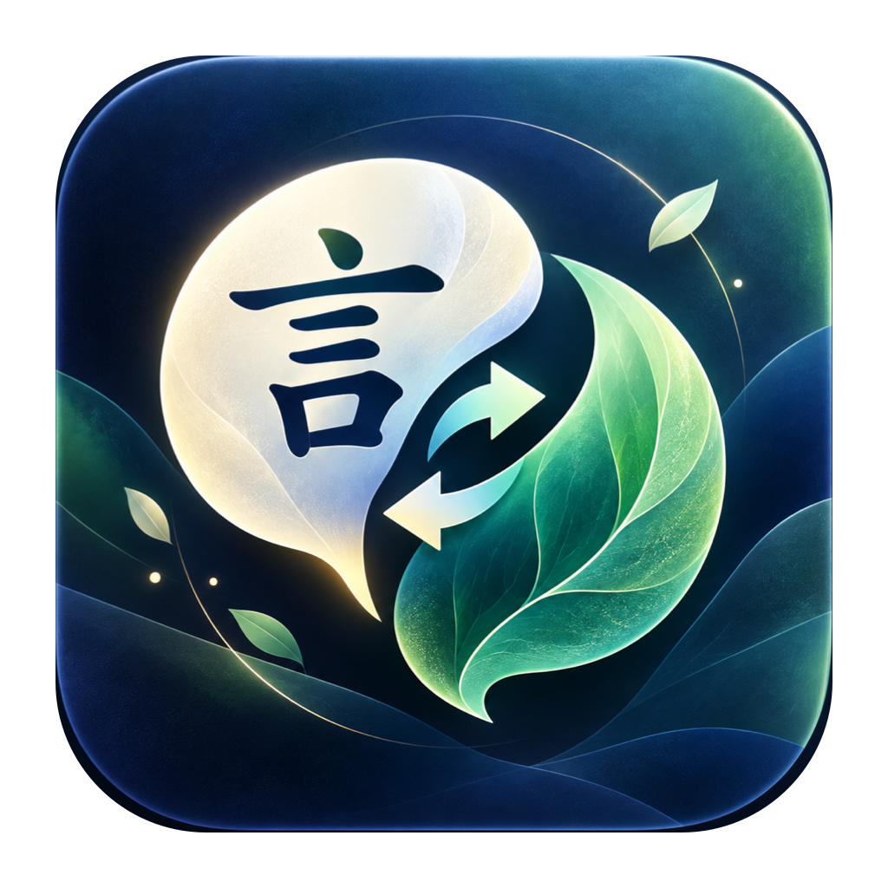
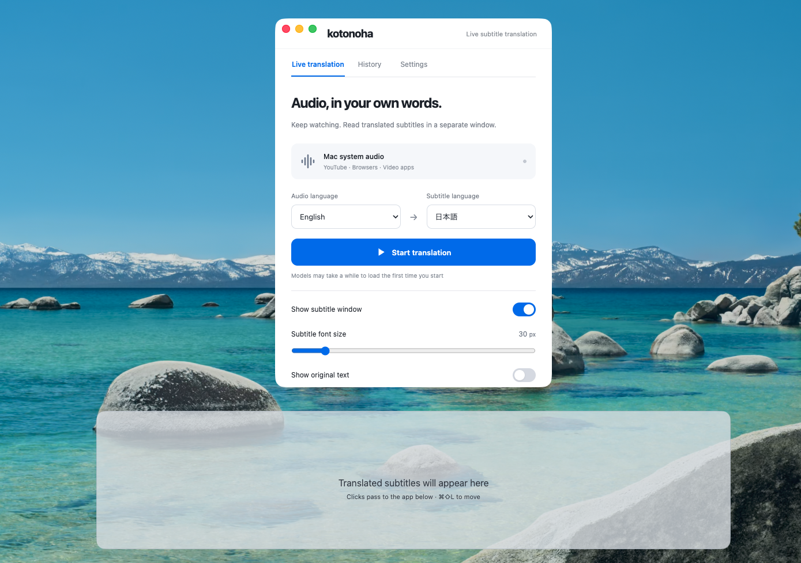
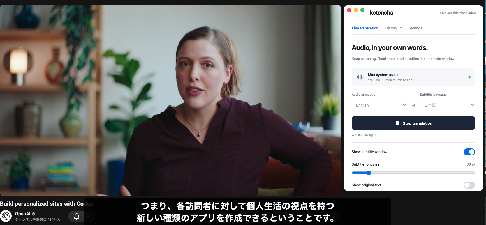
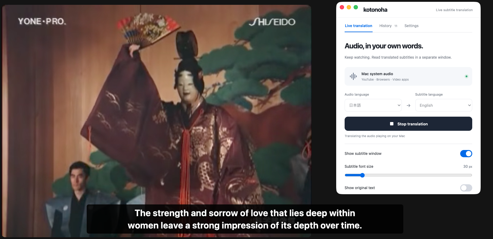

<table>
  <thead>
    <tr>
      <th style="text-align:center"><a href="README_ja.md">日本語</a></th>
      <th style="text-align:center"><a href="README.md">English</a></th>
    </tr>
  </thead>
</table>

<p align="center">
  
</p>

# kotonoha

**Live translated subtitles for the audio playing on your Mac.**

Keep watching in YouTube, your browser, or your usual video player. kotonoha captures Mac system audio, transcribes it locally, and displays translated captions in a separate, transparent window above your other apps.

Built for **Apple silicon Macs running macOS 26 or later**. Transcription and translation run on your Mac after model download, without a cloud inference API, microphone, or virtual audio driver.

<p align="center">
  
</p>

The compact controller and subtitle window are independent. The light-gray guide shows the subtitle area while it is empty; during playback, the surrounding window is transparent.

[Features](#features) · [Setup](#setup) · [Local app packaging](#local-app-packaging) · [Usage](#usage) · [Development](#development)

## Features

- **Subtitles over your existing apps.** Move and resize the floating subtitle window, then lock it so clicks pass through to the app below.
- **Local speech and translation.** Nemotron 3.5 transcribes through NeMo-Speech.cpp with Metal; PLaMo 3 Translate 0.8B, quantized to GGUF Q8_0, translates through llama.cpp with Metal.
- **Eight selectable languages.** English, Japanese, German, French, Spanish, Italian, Chinese (Simplified), and Korean are available for both audio and subtitles.
- **Adjustable display.** Set text size, original-text visibility, background opacity, and caption expiry.
- **Japanese and English controls.** Change the interface language independently of the audio/subtitle language pair.
- **Session history and export.** Review the latest 1,000 caption entries and explicitly export TXT or SRT. History stays in memory and is cleared when the app quits.

### English audio → Japanese subtitles

<p align="center">
  
</p>

### Japanese audio → English subtitles

<p align="center">
  
</p>

These screenshots show the app in use; they are examples, not accuracy or latency benchmarks.

## Setup

**Clone this repository and build on the Mac where you will use the app.** The app requires locally installed tools and model files; the `.app` alone is not a standalone installer.

### Requirements

| Requirement | Version / detail |
| --- | --- |
| Mac | Apple silicon (arm64), macOS 26+ |
| Desktop session | Logged-in graphical session with an available display |
| Node.js / npm | Node.js 26.5+ and npm 12.0.1+ |
| Python | Python 3.13, managed with `uv` |
| Native toolchain | Xcode command-line tools with a macOS 26+ SDK |
| Speech runtime | arm64 `nemo-speech` CLI with Metal support |
| Translation runtime | arm64 `llama-server` from llama.cpp 1.0.0 or later with Metal support |
| Model preparation | Internet access to download the speech and translation models |

### Prepare the tools once

Install Git and the macOS SDK/Swift toolchain using Xcode or `xcode-select --install`. Install [Node.js](https://nodejs.org/en/download) **26.5 or later** with **npm 12.0.1 or later**, and [uv](https://docs.astral.sh/uv/getting-started/installation/). On a Mac with Homebrew, uv and Python can be prepared with:

```sh
brew install uv llama.cpp
uv python install 3.13
```

Install the Metal-enabled arm64 CLI using the [official NeMo-Speech.cpp installer](https://github.com/NVIDIA/NeMo-Speech.cpp/blob/main/docs/install.md), unless it is already installed:

```sh
curl -fsSL https://github.com/NVIDIA/NeMo-Speech.cpp/raw/main/scripts/install.sh | sh
```

Keep Python, NeMo, and llama.cpp installed after building. If you use custom installation paths, see [Custom paths](#custom-paths).

### Local app packaging

After preparing the tools above, clone [Shuichi346/kotonoha](https://github.com/Shuichi346/kotonoha) and build it:

```sh
git clone https://github.com/Shuichi346/kotonoha.git kotonoha
cd kotonoha
./scripts/build-app.sh
```

The script checks prerequisites, installs the locked dependencies, downloads the models, and builds and verifies the app. Initial setup requires an internet connection; cached model files are reused.

If a prerequisite is missing or unsupported, the script stops and reports the problem. To check your environment without installing dependencies or downloading models:

```sh
./scripts/build-app.sh --check
```

The script prints the generated app's full path under `release/build-<timestamp>-<process-id>/kotonoha-darwin-arm64/kotonoha.app`. It does not launch the app or request audio access.

The app also needs its local runtime directory:

```text
~/Library/Application Support/kotonoha/runtime/
```

Keep this directory, the installed Python/NeMo/llama.cpp tools, and the [model caches](#shared-model-caches) on the same Mac after moving the `.app`.

### Install and launch

After the script succeeds, move the generated `kotonoha.app` to `/Applications` on the same Mac. Quit any running kotonoha build, then open the new app in Finder. If replacing an app already in `/Applications`, keep the previous copy until the new build is confirmed working.

### Shared model caches

The build script downloads the models to the locations below. The two models total approximately 1.5 GiB; allow additional space for dependencies and app builds.

| Model | Default shared cache |
| --- | --- |
| [PLaMo 3 Translate 0.8B Q8_0](https://huggingface.co/mradermacher/plamo-3-translate-0.8b-GGUF/blob/main/plamo-3-translate-0.8b.Q8_0.gguf) | `~/.cache/huggingface/hub` |
| [Nemotron 3.5 ASR](https://huggingface.co/nvidia/nemotron-3.5-asr-streaming-0.6b), managed by NeMo | `~/Library/Caches/NeMoSpeech/models` |

Keep the cached files available. If they are missing, run `npm run prepare:models` before launching the app; normal startup does not download models. Models load on the first translation start and stay loaded between sessions. Once prepared, transcription and translation run locally.

See each model card for its terms. The original PLaMo model is [pfnet/plamo-3-translate-0.8b](https://huggingface.co/pfnet/plamo-3-translate-0.8b), provided under the PLaMo Community License.

## Usage

### First translation

1. Open kotonoha. The interface defaults to Japanese; choose **設定 → Language → English** for English controls.
2. Complete the audio-access guide if it appears. Use its explicit permission action, allow access in macOS, then return and check permission. This setup step does not start translation.
3. On **Live translation**, choose the audio language and subtitle language, for example **English → 日本語**.
4. Play a video in another app and click **Start translation**. The first start may take time while models load.
5. Read the translated captions in the floating window. Choose **Show subtitles only** to hide the controller while you watch.
6. Click **Stop translation** when finished. The app finishes the final utterance and pending translations before reporting that it has stopped.

The subtitle window starts locked. Unlock it to move or resize it, then lock it to let clicks pass through to the app below. During translation, it appears when captions arrive and hides when you stop.

### Controls and shortcuts

| Action | How |
| --- | --- |
| Show the controller | **⌘⇧K**, or use the leaf-shaped menu-bar icon |
| Lock / unlock subtitles | **⌘⇧L** |
| Move or resize subtitles | Unlock, then drag inside the subtitle area or resize its edges |
| Change caption appearance | **Live translation**; expand **Adjust appearance** for more options |
| Change interface language | **Settings → Language** |
| Adjust finalization requests | **Settings → Finalization request interval**, while translation is stopped |
| Export captions | **History → TXT** or **SRT** |
| Quit the app and its services | **⌘Q**, or **Quit kotonoha** in the menu bar |

Closing the controller hides it while the app keeps running. Use **⌘Q** to quit kotonoha completely. Your settings are saved between launches.

The finalization interval offers **5, 10, 15, 20, or 30 seconds**, defaults to **15 seconds**, and applies on the next Start. It controls how often the app asks the speech engine to finalize text during continuous speech. Pauses can finalize text sooner; the interval does not specify when captions will appear.

### Permissions and troubleshooting

| Symptom | What to check |
| --- | --- |
| Audio access is required | Use the app's guide. In **System Settings → Privacy & Security → Screen & System Audio Recording**, enable the relevant entry; macOS may show **kotonoha** or **LiveCaption Audio**. Return to the app and check access again. Restart kotonoha if macOS requires it. |
| A model shows **Setup needed** | Run `npm run prepare:models`; confirm the arm64 `nemo-speech` executable is available. |
| Startup reports a service conflict | Each service automatically tries five backup ports. If all candidates are occupied, check running apps or projects, free one of the listed ports, then restart kotonoha (or retry Start for NeMo). |
| Captions are missing | Confirm the audio language, video playback, and subtitle-window visibility. Some protected media cannot be captured. |
| Captions fall behind | Translation speed depends on audio and hardware. When its bounded queue fills, the app skips older waiting utterances and reports this in the status. |

Speech recognition and translation can make mistakes, especially with names, numbers, accents, overlapping voices, or specialized language. SRT exports use an approximate session timeline and are not synchronized to a source video file. The app does not automatically record audio or save transcripts; export history before quitting if you need it.

## Development

### Architecture

```text
Mac system audio
  → Swift / ScreenCaptureKit (16 kHz mono PCM16)
  → NeMo-Speech.cpp / Metal (streaming transcription)
  → PLaMo 3 Translate / llama.cpp (GGUF Q8_0) (translation)
  → Electron subtitle window
```

| Directory | Responsibility |
| --- | --- |
| [frontend/](frontend/) | React, TypeScript, and Vite controller and subtitle views |
| [desktop/](desktop/) | Electron windows, menus, shortcuts, preferences, IPC, exports, and process ownership |
| [backend/](backend/) | Python 3.13 / FastAPI service, streaming speech pipeline, and persistent llama.cpp GGUF translator |
| [native/](native/) | Swift system-audio capture helper; microphone capture is disabled and video samples are not delivered or stored |
| [scripts/](scripts/) | Build, model-runtime staging, packaging, architecture checks, and desktop smoke checks |

Electron manages the windows and authenticated local services. Python coordinates transcription and translation. Service protocols, port configuration, model selection, and process lifecycle are documented in [backend/README.md](backend/README.md).

After the initial build, use `npm start` to build and launch the app from the checkout. `npm run dev:web` previews the interface in a browser; live capture and the independent subtitle window require Electron. Rerun `./scripts/build-app.sh` to build an app containing your changes.

### Custom paths

The default installation paths require no configuration. For custom installations, set these environment variables before building and launching:

| Variable | Purpose |
| --- | --- |
| `NEMO_SPEECH_BIN` | Absolute path to the `nemo-speech` executable |
| `NEMO_SPEECH_MODEL_INDEX` | Absolute path to the model index for a custom NeMo source build |
| `KOTONOHA_LLAMA_SERVER` | Absolute path to `llama-server` |
| `HF_HOME` / `HF_HUB_CACHE` | Hugging Face cache location |
| `NEMO_SPEECH_MODEL_DIR` | NeMo model cache location |

Model preparation and app launch must use the same cache settings. Finder launches do not inherit shell configuration, so use the default paths when opening the app from Finder.

### Verification commands

```sh
npm run build
npx playwright install chromium
npm test
node --test tests/*.test.mjs
uv run --locked python -m pytest -q
uv run --locked ruff check backend
uv run --locked ruff format --check backend
./native/build.sh --verify
```

Install Chromium before running the UI tests, including after a Playwright update. Native verification checks the build, architecture, resampler, and permission status without requesting access or capturing audio.

The builder already verifies architecture. For an optional hidden startup check, replace `/full/path/to/kotonoha.app` below with the app path printed by the builder:

```sh
KOTONOHA_SMOKE_APP="/full/path/to/kotonoha.app/Contents/MacOS/kotonoha" node scripts/smoke-desktop.mjs
```

This checks the packaged app's versions, startup, and IPC with a temporary profile and hidden windows. It does not start audio capture or request permission.

See [native/README.md](native/README.md) for capture and permission behavior, and [CHANGELOG.md](CHANGELOG.md) for changes between versions.
