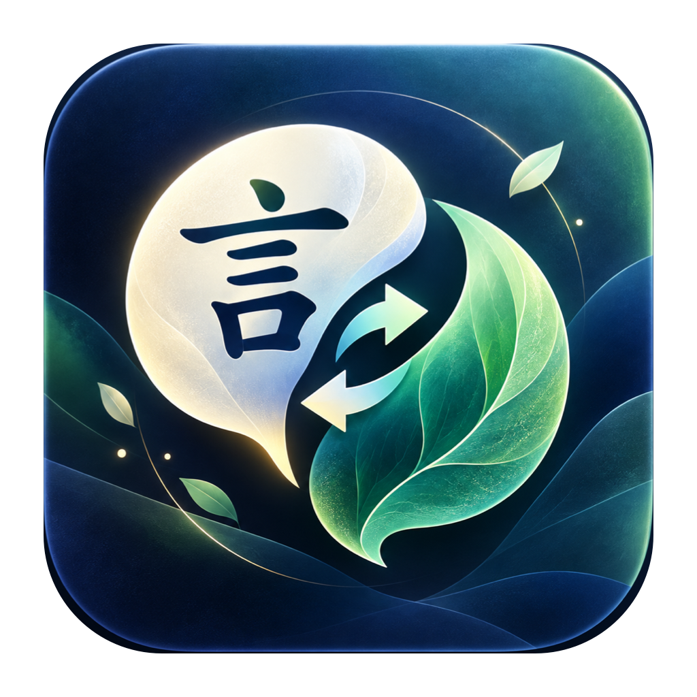
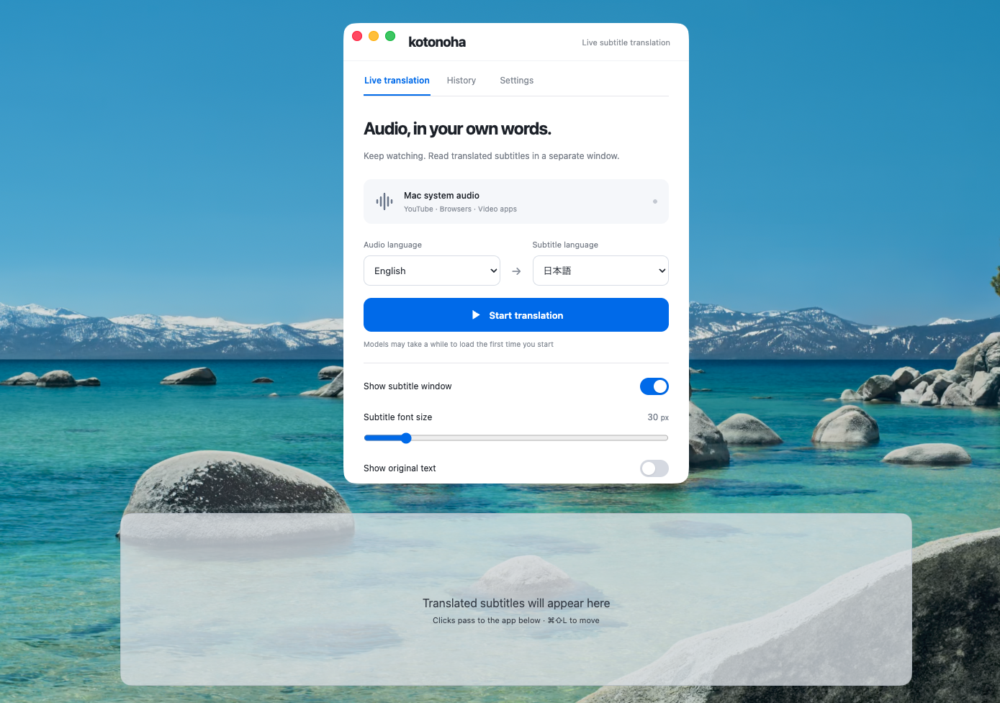
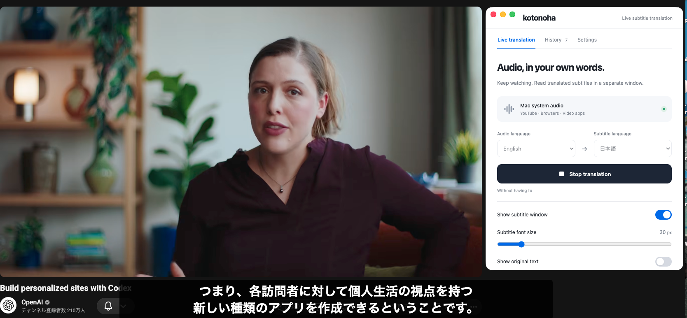
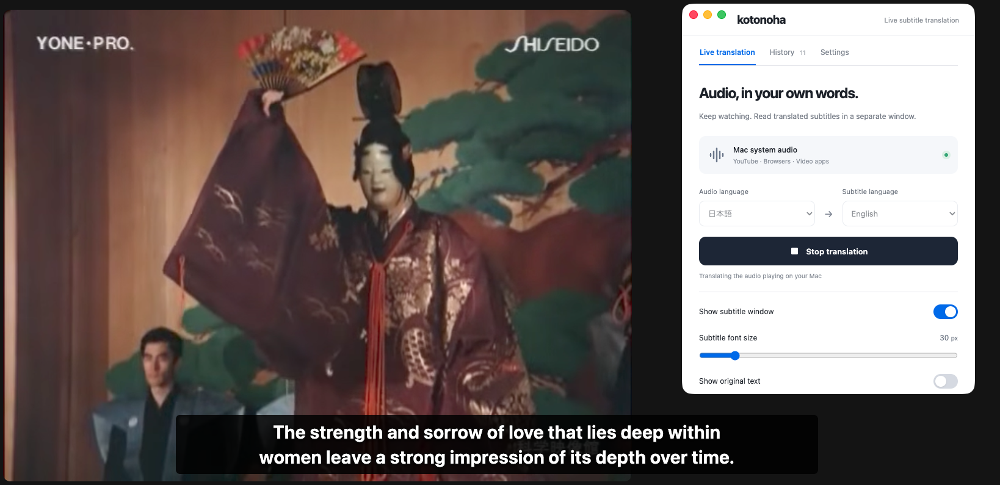

<table>
  <thead>
    <tr>
      <th style="text-align:center"><a href="README_ja.md">日本語</a></th>
      <th style="text-align:center"><a href="README.md">English</a></th>
    </tr>
  </thead>
</table>

<p align="center">
  
</p>

# kotonoha

**Macで再生中の音声をリアルタイムで翻訳し、字幕を表示します。**

YouTubeやブラウザ、普段使っている動画プレーヤーでそのまま視聴できます。kotonohaはMacのシステム音声を取り込み、ローカルで文字起こしを行い、ほかのアプリの前面に表示される独立した透明ウィンドウに翻訳字幕を表示します。

**Apple silicon搭載のmacOS 26以降のMac**向けです。モデルのダウンロード後、文字起こしと翻訳はMac上で実行されます。クラウド推論API、マイク、仮想オーディオドライバーは使いません。

<p align="center">
  
</p>

コンパクトなコントローラーと字幕ウィンドウは独立しています。字幕がないときは薄いグレーのガイドで字幕領域を示し、再生中はウィンドウの周囲が透明になります。

[主な機能](#主な機能) · [セットアップ](#セットアップ) · [ローカルアプリのパッケージ](#ローカルアプリのパッケージ) · [使い方](#使い方) · [開発](#開発)

## 主な機能

- **使用中のアプリに重ねて字幕を表示。** 字幕ウィンドウを移動・サイズ変更し、ロックするとクリックが下のアプリに届きます。
- **音声認識と翻訳をローカルで実行。** Nemotron 3.5がNeMo-Speech.cppとMetalを使って文字起こしし、4-bit量子化したHy-MT2 1.8BがMLXを使って翻訳します。
- **9言語を選択可能。** 音声と字幕の言語として、英語、日本語、ドイツ語、フランス語、スペイン語、イタリア語、ポルトガル語、中国語、韓国語を選べます。
- **字幕表示を調整。** 文字サイズ、原文の表示、背景の不透明度、字幕の表示時間を設定できます。新しい設定では文字サイズは30 px、原文表示はオフです。
- **日本語と英語の操作画面。** 音声・字幕の言語ペアとは別に、画面の表示言語を切り替えられます。
- **セッション履歴と書き出し。** 直近1,000件の字幕を確認し、TXTまたはSRTに明示的に書き出せます。履歴はメモリ上に保持され、アプリ終了時に消去されます。

### 英語音声 → 日本語字幕

<p align="center">
  
</p>

### 日本語音声 → 英語字幕

<p align="center">
  
</p>

スクリーンショットはアプリの使用例です。認識精度や遅延を示すベンチマークではありません。

## セットアップ

**各自のMacでこのリポジトリをcloneしてビルドする方式**です。作成した`.app`は、その利用者が導入したPython・NeMo、共有モデルキャッシュ、ローカルの実行環境を使います。他人が作った`.app`だけをコピーして使う方式には対応していません。署名・公証済みのスタンドアロンインストーラーではありません。

### 必要な環境

| 要件 | バージョン / 詳細 |
| --- | --- |
| Mac | Apple silicon (arm64)、macOS 26+ |
| デスクトップ環境 | ディスプレイを利用できるログイン済みのグラフィカルセッション |
| Node.js / npm | Node.js 26.5+、npm 12.0.1+ |
| Python | Python 3.13、`uv`で管理 |
| ネイティブツールチェーン | macOS SDKを含むXcodeコマンドラインツール |
| 音声認識ランタイム | Metal対応のarm64版`nemo-speech` CLI。0.2.0で動作確認済み |
| モデルの準備 | 音声認識・翻訳モデルのダウンロードに必要なインターネット接続 |

### 事前準備（初回のみ）

Xcodeまたは`xcode-select --install`でGitとmacOS SDK・Swiftツールチェーンを導入します。[Node.js](https://nodejs.org/en/download) **26.5以降**と**npm 12.0.1以降**、[uv](https://docs.astral.sh/uv/getting-started/installation/)も必要です。Homebrew導入済みなら、uvとPythonは次のように準備できます。

```sh
brew install uv
uv python install 3.13
```

NeMo未導入の場合は、[公式インストーラー](https://github.com/NVIDIA/NeMo-Speech.cpp/blob/main/docs/install.md)でMetal対応のarm64版CLIを導入します。導入済みなら再インストールは不要です。

```sh
curl -fsSL https://github.com/NVIDIA/NeMo-Speech.cpp/raw/main/scripts/install.sh | sh
```

下記のビルドスクリプトでarm64版であることとMetal対応を確認します。NeMoは0.2.0で動作確認済みです。アプリはインストール済みCLIを`PATH`、`~/.local/bin/nemo-speech`の順で探し、別のNeMoをビルド・同梱しません。標準以外の場所に導入した場合は`NEMO_SPEECH_BIN`に実行ファイルの絶対パスを指定できます。ソースから導入してモデル索引が`<実体の実行ファイルのprefix>/share/nemo-speech/model-index.json`にない場合は、`NEMO_SPEECH_MODEL_INDEX`にも索引の絶対パスを指定してください。

### ローカルアプリのパッケージ

上記のツールを準備したら、GitHubの**Code**メニューからこのリポジトリのclone URLをコピーし、次の`REPOSITORY_URL`を置き換えて実行します。

```sh
git clone REPOSITORY_URL kotonoha
cd kotonoha
./scripts/build-app.sh
```

このスクリプト1本で、環境チェック、`package-lock.json`と`uv.lock`に従った依存関係の導入、ElectronとPython 3.13の準備、`npm run prepare:models`によるモデル準備、画面・ネイティブヘルパー・`.app`のビルド、arm64対応の検証まで実行します。初回はインターネット接続が必要です。保存済みのモデルは再利用します。

環境チェックでは、`git --version`、`xcrun swift --version`、`node --version`、`npm --version`、`uv --version`、`nemo-speech --version`、`nemo-speech doctor`を実行します。macOS 26以降、arm64で動作するターミナルとツールチェーン、macOS 26以降のSDK、Node.js 26.5以降、npm 12.0.1以降、NeMoのarm64・Metal対応も判定します。不足や非対応があれば依存関係の導入前に停止します。Xcode・Node.js・uv・NeMo自体は上記の手順で事前に導入してください。環境チェックだけ行う場合は、次を使います。依存関係の導入やモデルのダウンロードは行いません。

```sh
./scripts/build-app.sh --check
```

生成先は`release/build-<日時>-<プロセスID>/kotonoha-darwin-arm64/kotonoha.app`で、完了時にフルパスを表示します。以前のアプリは残します。スクリプトはアプリの起動や録音許可の要求を行いません。依存関係とモデルの準備済み環境では、従来の個別コマンド`npm run package`も使えます。既定の生成先は`release/kotonoha-darwin-arm64/kotonoha.app`で、その後に`npm run check:architecture`を実行します。

パッケージ化では、Python環境、バックエンド、ネイティブ音声取り込みヘルパーを、次の場所にあるバージョン別スナップショットに格納します。

```text
~/Library/Application Support/kotonoha/runtime/
```

アプリ内の`Contents/Resources/runtime.json`が使用するスナップショットを選択します。パッケージ版の起動時にソースチェックアウト内の依存関係は読み込まれません。`.app`を移動しても、選択されたスナップショット、インストール済みのベースPython、NeMo実行ファイルとモデル索引、共有モデルキャッシュは残してください。バックエンドコード、Python依存関係、ネイティブヘルパーを変更した場合は再パッケージ化します。翻訳モデルの固定リビジョンを変更した場合もモデル準備と再パッケージ化が必要です。新しいスナップショットにモデルの重みは含まれません。古いスナップショットとモデルは保持します。他の利用者も、それぞれのMacでclone・事前準備・ビルドを行ってください。

### インストールと起動

スクリプトが正常終了したら、生成された`kotonoha.app`を同じMacの`/Applications`へ移動します。起動中のkotonohaを終了してから、新しいアプリをFinderで開いてください。`/Applications`の既存アプリを置き換える場合は、新しいビルドの動作を確認するまで以前のコピーを残してください。

開発時は、スクリプトで依存関係とモデルを準備した後、チェックアウト内で`npm start`を実行できます。フロントエンドの型を確認して画面をビルドし、Electronを起動します。

### 共有モデルキャッシュ

`npm run prepare:models`は次の共有キャッシュを準備し、保存済みファイルを再利用します。モデルのパスを手動指定する必要はありません。使用する2モデルは合計約1.7 GiBで、ほかに依存関係とアプリのビルド用の空き容量が必要です。利用条件は各モデルカードを確認してください。

| モデル | 標準の共有キャッシュ |
| --- | --- |
| [Hy-MT2-1.8B-4bit](https://huggingface.co/mlx-community/Hy-MT2-1.8B-4bit) | `~/.cache/huggingface/hub` |
| [Nemotron 3.5 ASR](https://huggingface.co/nvidia/nemotron-3.5-asr-streaming-0.6b)（NeMoが管理） | `~/Library/Caches/NeMoSpeech/models` |

翻訳モデルはキャッシュ内の最新版ではなく、[backend/config.py](backend/config.py)に固定されたリビジョンを使います。NeMoはインストール済みのモデル索引から`nemotron-3.5`を選びます。起動環境で指定された`HF_HOME` / `HF_HUB_CACHE`と`NEMO_SPEECH_MODEL_DIR`にも対応しますが、Finder起動はシェル設定を引き継がないため標準の保存先を推奨します。準備と起動で同じキャッシュ設定を使ってください。[Hugging Faceの説明](https://huggingface.co/docs/huggingface_hub/guides/manage-cache)と[NeMoの説明](https://github.com/NVIDIA/NeMo-Speech.cpp/blob/main/docs/cli.md#models-and-cache)も参照できます。

新しいビルドはモデルをチェックアウトやアプリの実行環境へコピーしません。従来の`models/`と古い実行環境スナップショットは削除せず残しますが、新しいビルドでは使用しません。共有キャッシュは残してください。削除した場合は`npm run prepare:models`で再準備します。通常起動と状態確認ではモデルのダウンロードやメモリへの読み込みを行いません。

モデルは翻訳を初めて開始すると読み込まれ、セッション間もメモリ上に保持されます。準備後の文字起こしと翻訳にはローカルのモデルファイルを使用します。

## 使い方

### 初回の翻訳

1. kotonohaを開きます。画面の表示言語は日本語です。英語にするには**設定 → Language → English**を選びます。
2. 音声アクセスのガイドが表示されたら案内に従います。ガイド内の許可操作を実行し、macOSで許可した後、アプリに戻ってアクセスを確認します。この設定手順では翻訳は始まりません。
3. **ライブ翻訳**画面で音声の言語と字幕の言語を選びます。例：**English → 日本語**。
4. 別のアプリで動画を再生し、**翻訳を開始**をクリックします。初回はモデルの読み込みに時間がかかる場合があります。
5. 浮動ウィンドウで翻訳字幕を読みます。視聴中にコントローラーを隠すには**字幕だけにする**を選びます。
6. 終了したら**翻訳を停止**をクリックします。停止を知らせる前に、最後の発話と保留中の翻訳が処理されます。

字幕ウィンドウは、空の領域ガイドを表示したロック状態で最初に表示されます。セッションを開始すると字幕が消去され、最初の翻訳字幕が届くまでウィンドウは非表示になります。ロック中はクリックが下のアプリに届きます。移動やサイズ変更をするにはロックを解除してください。翻訳を停止すると字幕ウィンドウは非表示になり、表示がリセットされます。

### 操作とショートカット

| 操作 | 方法 |
| --- | --- |
| コントローラーを表示 | **⌘⇧K**、または葉の形のメニューバーアイコンを使用 |
| 字幕をロック / 解除 | **⌘⇧L** |
| 字幕を移動・サイズ変更 | ロックを解除し、字幕領域内をドラッグするか、端をドラッグしてサイズを変更 |
| 字幕の見た目を変更 | **ライブ翻訳**を開き、**表示を調整**を展開 |
| 画面の表示言語を変更 | **設定 → Language** |
| 確定要求の間隔を調整 | 翻訳停止中に**設定 → 確定要求の間隔**を開く |
| 字幕を書き出す | **履歴 → TXT**または**SRT** |
| アプリとサービスを終了 | **⌘Q**、またはメニューバーの**kotonohaを終了** |

コントローラーを閉じると、アプリの動作を続けたままコントローラーが隠れます。音声関連プロセスとモデル関連プロセスをすべて終了するにはkotonohaを終了してください。設定は次回起動時も保持されます。以前のkotoba設定は、従来のプロファイルを上書きせずに取り込みます。

確定要求の間隔は**5、10、15、20、30秒**から選べます。初期値は**15秒**で、次回の開始時から適用されます。連続して話している間に追加の要求を送ります。自然な発話境界の検出は600 msで引き続き動作します。この設定は字幕の表示遅延を保証するものではありません。

### 許可とトラブルシューティング

| 症状 | 確認すること |
| --- | --- |
| 音声アクセスが必要と表示される | アプリのガイドを使います。**システム設定 → プライバシーとセキュリティ → 画面収録とシステムオーディオ録音**で該当項目を有効にします。macOS上では**kotonoha**または**LiveCaption Audio**と表示される場合があります。アプリに戻り、アクセスをもう一度確認します。macOSから求められた場合はkotonohaを再起動してください。 |
| モデルに**要準備**と表示される | `npm run prepare:models`を実行し、arm64版`nemo-speech`実行ファイルが利用できることを確認します。 |
| 起動時にサービスの競合が報告される | 起動前に別のkotonohaビルドを終了します。本番サービスはループバックポート8765と8766を使用します。 |
| 字幕が表示されない | 音声の言語、動画の再生、字幕ウィンドウの表示状態を確認します。保護されたメディアの一部は取り込めません。 |
| 字幕が遅れる | 翻訳速度は音声とハードウェアによって異なります。上限のあるキューがいっぱいになると、古い未処理の発話をスキップし、ステータスに表示します。 |

音声認識と翻訳には誤りが生じることがあります。特に人名、数値、アクセント、複数人の重なった発話、専門用語では誤りやすくなります。SRT書き出しの時刻はセッション内の概算で、元動画ファイルとは同期されません。アプリは音声を自動録音したり、文字起こしを自動保存したりしません。必要な場合は終了前に履歴を書き出してください。

## 開発

### アーキテクチャ

```text
Macのシステム音声
  → Swift / ScreenCaptureKit (16 kHz mono PCM16)
  → NeMo-Speech.cpp / Metal (ストリーミング文字起こし)
  → Hy-MT2 / MLX (翻訳)
  → Electron字幕ウィンドウ
```

| ディレクトリ | 役割 |
| --- | --- |
| [frontend/](frontend/) | React、TypeScript、Viteを使ったコントローラーと字幕画面 |
| [desktop/](desktop/) | Electronウィンドウ、メニュー、ショートカット、設定、IPC、書き出し、プロセス管理 |
| [backend/](backend/) | Python 3.13 / FastAPIサービス、ストリーミング音声処理、常駐MLX翻訳エンジン |
| [native/](native/) | Swift製のシステム音声取り込みヘルパー。マイク入力は無効で、動画サンプルは配信・保存されません |
| [scripts/](scripts/) | ビルド、モデルランタイムの準備、パッケージ化、アーキテクチャ確認、デスクトップのスモークチェック |

Electronのメインプロセスがローカルサービスの認証情報を管理します。Pythonサービスは認証付きのループバックポート**8765**で、NeMoは**8766**で待ち受けます。レンダラーからNode.jsにはアクセスできません。終了時にバックエンドのプロセスグループと、そこから起動したサービスを終了します。

`npm run dev:web`でブラウザー上の画面プレビューを起動できます。実際の音声取り込みと独立した字幕ウィンドウにはElectronが必要です。

### 確認用コマンド

```sh
npm run build
npx playwright install chromium
npm test
node --test tests/*.test.mjs
uv run --locked python -m pytest -q
uv run --locked ruff check backend
uv run --locked ruff format --check backend
./native/build.sh --verify
```

スクリプトによるUIテストの前にChromiumを一度インストールしてください。フロントエンドのスクリプトはビルドとテストの実行時間に上限を設けています。ネイティブ検証では、アクセス許可の要求や音声の取り込みを行わず、ビルド、アーキテクチャ、リサンプラー、許可状態を確認します。

arm64対応はビルドスクリプト内で検証します。追加で非表示の起動チェックを行う場合は、次の`/full/path/to/kotonoha.app`を、スクリプトが表示したアプリのパスに置き換えてください。

```sh
KOTONOHA_SMOKE_APP="/full/path/to/kotonoha.app/Contents/MacOS/kotonoha" node scripts/smoke-desktop.mjs
```

非表示のデスクトップスモークテストは一時プロファイルとポート**8767**を使い、起動とIPCを確認します。音声取り込みが始まる前にStartを捕捉するため、実際の音声配信やmacOSの許可ダイアログ操作は検証しません。

プロトコルの詳細とモデル検証の根拠は[backend/README.md](backend/README.md)、音声取り込みと許可の動作は[native/README.md](native/README.md)にあります。[PLANS.md](PLANS.md)で実装の受け入れ状況を管理し、[NOTES.md](NOTES.md)に設計上の理由を記録しています。
